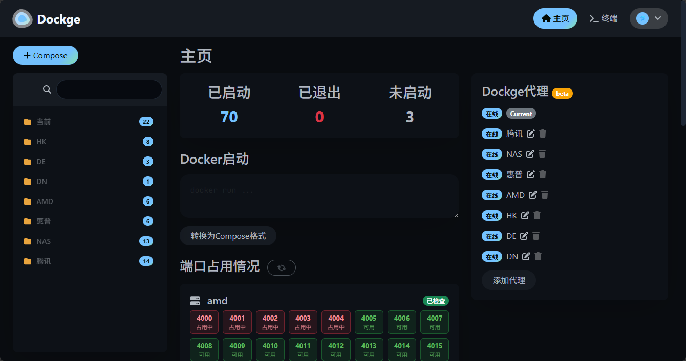

<div align="center" width="100%">
    
</div>

<h1 align="center">Dockge <span style="font-size:18px;vertical-align:middle">⚡ Enhanced Edition</span></h1>

<p align="center">
    A fancy, easy-to-use and reactive self-hosted <code>docker compose.yaml</code> stack-oriented manager.
</p>

<p align="center">
    
    
    
</p>

<p align="center">
    
</p>

---

## ⭐ 功能特性

### 核心管理

- 🧑‍💼 管理所有 `compose.yaml`：创建 / 编辑 / 启动 / 停止 / 重启 / 删除
- 🔄 一键更新 Docker 镜像
- ⌨️ `compose.yaml` 交互式编辑器
- 🦦 交互式 Web 终端
- 🏪 将 `docker run ...` 命令一键转换为 `compose.yaml`
- 📙 基于文件存储 —— 不绑架你的 compose 文件，可直接用 `docker compose` 命令操作
- 🚄 全响应式 —— Pull / Up / Down 进度与终端输出实时显示

### ✨ 本 Fork 增强

| 特性 | 说明 |
| --- | --- |
| 🗂️ **远端文件夹化** | 多个远端主机在左侧以**文件夹**形式展示，点击即可展开 / 收拢，本地默认展开、远端默认收起，状态自动记忆 |
| 🏷️ **远端别名** | 为每个远端设置友好别名，界面显示更清晰 |
| 🖥️ **静态端口显示** | 主页直接展示本机与所有远端主机的端口占用情况，**无需运行时探测**，只需一份 JSON 配置文件 |

---

## 🖥️ 端口占用显示（静态配置）

端口信息**不由 Dockge 运行时探测**，而是提前用 SSH 等方式收集后写入一份 JSON 配置文件 `data/ports.json`，Dockge 启动后直接解析并展示在主页。

### 配置文件格式

文件：`{数据目录}/ports.json`

```json
{
  "amd":   { "4000": true,  "4001": false, "4002": true },
  "piper": { "4000": false, "4001": true,  "4002": false }
}
```

- 顶层键 = 主机名（用作每张卡片标题）
- 每台主机的值 = `{ 端口号: 是否占用 }`
  - `true` = 端口被占用（红色）
  - `false` = 端口可用（绿色）

配置了远端 Agent 后，Dockge 会合并每个在线 Agent 返回的端口信息，从而在同一页面展示所有主机的端口状态。

---

## 🔧 安装

### 环境要求

- Docker 20+ / Podman（Podman 需 `podman-docker`）
- 架构：`amd64`、`arm64`、`armv7`

### 国内镜像加速构建

本 Fork 的 `docker/Dockerfile` 使用了国内可访问的镜像源 `o-o.men/louislam/dockge:base`，避免因网络问题导致构建失败。

### 构建 & 启动

```bash
# 在项目根目录
docker build -f docker/Dockerfile -t dockge:latest .

# 启动
docker run -d \
  --name dockge \
  -p 5001:5001 \
  -v /var/run/docker.sock:/var/run/docker.sock \
  -v /opt/stacks:/opt/stacks \
  -v ./data:/app/data \
  -e DOCKGE_STACKS_DIR=/opt/stacks \
  dockge:latest
```

启动后访问 `http://localhost:5001`。

> 端口配置文件 `data/ports.json` 放入挂载的 `./data` 目录即可。

---

## 🗣️ 反馈 & 贡献

- 遇到问题：请到 [Issues](https://github.com/piper-1136/dockge/issues) 反馈
- 讨论交流：[Discussions](https://github.com/piper-1136/dockge/discussions)

---

## 📄 说明

Dockge 构建在 [Compose V2](https://docs.docker.com/compose/migrate/) 之上。`compose.yaml` 即 `docker-compose.yml`。

> 本项目基于 [louislam/dockge](https://github.com/louislam/dockge) 修改增强。